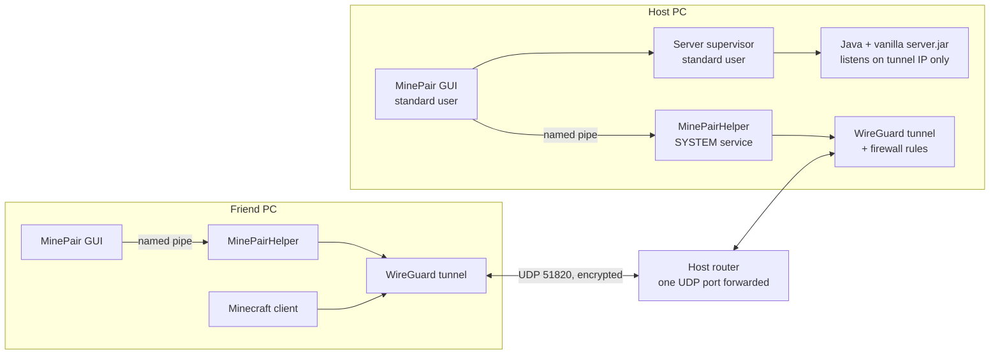

# MinePair

[](https://github.com/IlliaAnikushyn/MinePair/actions/workflows/build.yml)
[](LICENSE)


**Host a private Minecraft: Java Edition server for you and one friend — over an encrypted WireGuard tunnel between just your two computers.**

MinePair is a single Windows executable that sets up everything two players need: the official vanilla server, a portable Java runtime and a point-to-point [WireGuard](https://www.wireguard.com/) network. The game port is never exposed to the internet, and nothing runs as administrator except a tiny helper service with a fixed list of actions.

It is a lightweight alternative to hosted servers (which add latency) and to general-purpose VPNs such as Radmin VPN or Hamachi (which connect whole networks).

## Contents

- [Features](#features)
- [How it works](#how-it-works)
- [Requirements](#requirements)
- [Getting started](#getting-started)
- [Security model](#security-model)
- [Where data lives](#where-data-lives)
- [Worlds and backups](#worlds-and-backups)
- [Troubleshooting](#troubleshooting)
- [Uninstalling](#uninstalling)
- [Building from source](#building-from-source)
- [Project structure](#project-structure)
- [Limitations](#limitations)
- [About this project](#about-this-project)
- [Contributing](#contributing) · [License](#license) · [Disclaimer](#disclaimer)

## Features

- **Setup wizard** — choose "I host the server" or "I join a friend", enter two nicknames, click *Start setup*. One UAC prompt, ever.
- **Pairing by chat** — exchange two short text codes (`MP-…`) in any messenger and compare a 12-digit safety code by voice. Codes contain only public keys and connection details.
- **Private tunnel** — a dedicated WireGuard interface with two `/32` addresses. No default route, no DNS changes, no access to the rest of either network.
- **Narrow firewall** — the Minecraft port accepts only the friend's tunnel address, only on the tunnel interface, only for MinePair's own `java.exe`.
- **Verified downloads** — Minecraft `server.jar` (SHA-1 from Mojang's manifest), Temurin Java (SHA-256 from the Adoptium API), WireGuard (Authenticode pinned to WireGuard LLC).
- **Multiple worlds** — each with its own Minecraft version, game mode, difficulty, PvP, hardcore and seed; the matching Java is fetched automatically.
- **Backups** — automatic backup before every start (last 10 kept), manual backups, safe restore with a safety copy.
- **Changing IPs handled** — the host detects a new public IP and gives the friend a one-line update code; no re-pairing.
- **Clean rollback** — stopping removes the tunnel and every firewall rule MinePair created; uninstalling removes the helper and, if MinePair installed it, WireGuard.

## How it works



1. Each computer generates its own X25519 key pair locally; private keys never leave the machine.
2. The host sends an **invitation code** (host public key, public IP, port, tunnel addresses, nicknames). The friend answers with a **reply code** (friend public key). Both screens show the same **safety code** derived from both keys; the host confirms it before the friend's key is accepted.
3. When the host presses **Play**, the helper installs a WireGuard tunnel service with exactly one peer and creates interface-scoped firewall rules; then a supervisor process starts the vanilla server bound to the tunnel address.
4. The friend presses **Connect** and joins `10.203.x.y` in Minecraft (*Multiplayer → Direct Connection*).

The full requirements and design decisions are in [docs/SPEC.md](docs/SPEC.md).

## Requirements

- Windows 10 or 11, x64, with .NET Framework 4.8 (built into current Windows).
- **Host:** a public IPv4 address (no CGNAT) and the ability to forward **one UDP port** (51820) on the router — or UPnP already enabled.
- **Friend:** nothing special; their router is not touched.
- A Minecraft: Java Edition client on both computers. The server runs in offline mode (see [Security model](#security-model)).

## Getting started

Download `MinePair.exe` from the [Releases](https://github.com/IlliaAnikushyn/MinePair/releases) page (or [build it](#building-from-source)) and start it with a normal double-click — not "Run as administrator".

> **Windows SmartScreen:** the executable is not code-signed, so Windows may show "Windows protected your PC". Choose *More info → Run anyway* only if you downloaded it from this repository or built it yourself. Never disable your antivirus or firewall to run it.

### Host

1. *I host the server* → enter your nickname and your friend's exactly as in the launcher, accept the [Minecraft EULA](https://www.minecraft.net/eula).
2. *Start setup* and click **Yes** in the Windows prompt. MinePair downloads WireGuard, Java and the latest Minecraft release.
3. Copy the invitation code and send it, together with `MinePair.exe`, to your friend.
4. Paste your friend's reply code and compare the safety code (e.g. `2D51-3B2F-9C04`) with them by voice.
5. Forward **UDP 51820** on your router to the address the program shows (or try the UPnP button). Do **not** forward TCP 25565 and do not enable DMZ.
6. From now on: **Play**, then in Minecraft use the address shown (*Copy* button).

### Friend

1. *I join a friend* → *Start setup* → click **Yes** once. Only WireGuard is installed.
2. Paste the host's invitation, send back the reply code, compare the safety code.
3. From now on: **Connect** when your friend has pressed Play, then join the same address with the nickname the program shows.

If the host's public IP changes, the host's app shows a short code; the friend pastes it with *Paste code from friend*.

## Security model

What MinePair protects against:

- **Strangers on the internet.** The only open port is WireGuard's UDP port, which silently drops anything not encrypted with the friend's key. TCP 25565 is never exposed; the server binds to the tunnel address only.
- **Lateral access.** The tunnel routes two `/32` addresses. On the host, firewall rules on the tunnel interface allow the friend only to the Minecraft port; on the friend's PC all unsolicited inbound traffic from the tunnel is blocked.
- **Swapped codes.** A person who can modify your chat could replace both codes; the 48-bit safety code read aloud detects that.
- **Tampered downloads.** Hashes and signatures are checked before anything is used or installed.
- **Privilege escalation through MinePair.** The GUI and the server run as the standard user. The SYSTEM helper only accepts a fixed set of actions over a pipe restricted to the installing user, runs a script embedded in its own executable from Program Files, keeps its state in an admin-only folder in ProgramData and talks only to a pipe server running as a service.

What it does **not** protect against:

- **Nickname spoofing inside the tunnel.** The server runs in `online-mode=false`; the whitelist checks names, not identities. Only the paired device can reach the server, so this matters only if that device is compromised.
- **Malware already running on either computer** under your account or as administrator.
- **Network quality.** No setup can guarantee the absence of latency or packet loss.

Key storage: the device private key is encrypted with per-user DPAPI. The tunnel configuration WireGuard needs is encrypted with machine-wide DPAPI (the SYSTEM service must read it) and is stored only in `C:\ProgramData\MinePair` (SYSTEM and Administrators only); the copy handed to the helper is deleted from your data folder right after the tunnel starts.

Found a vulnerability? Please follow [SECURITY.md](SECURITY.md).

## Where data lives

| Location | Contents | Access |
| --- | --- | --- |
| `%LOCALAPPDATA%\MinePair` | settings, keys, worlds, backups, Java, server jars, logs | you, SYSTEM, Administrators |
| `C:\Program Files\MinePair` | helper copy of `MinePair.exe` and `Network.ps1` | read-only for users |
| `C:\ProgramData\MinePair` | network journal, tunnel configuration, helper log | SYSTEM, Administrators |

The first version kept its data in `.local` next to the exe; it is migrated to `%LOCALAPPDATA%\MinePair` automatically on first start.

## Worlds and backups

*Settings → Worlds* lists your worlds. Each one stores its version, game mode, difficulty, PvP, hardcore and seed; switch worlds with *Switch world* while the server is stopped.

The current world is backed up before every start; the last 10 automatic backups are kept and manual backups are never deleted. *Restore from backup* validates the archive, saves the current state as a separate backup and then replaces the world. If the computer turned off during a game, the next *Play* warns you, takes a backup and continues.

## Troubleshooting

*Settings → Check connection* reports whether the tunnel is up, when the last WireGuard handshake with your friend happened, whether Minecraft responds (with a real status/ping exchange) and whether your public or internal IP changed. A TCP ping does not measure packet loss or server TPS.

| Symptom | Likely cause |
| --- | --- |
| "No contact with your friend yet" | the friend has not pressed *Connect*, or UDP 51820 is not forwarded to the host |
| Worked yesterday, not today | the host's public IP changed — send the new-address code; or the host's internal IP changed — update the router rule |
| "The administrator prompt was cancelled" | click the button again and choose **Yes** |

Logs: *Settings → Server log* (`logs\server-console.log`) and `application-errors.log` in the data folder; the helper writes to `C:\ProgramData\MinePair\helper.log` and `network-actions.log`.

## Uninstalling

*Settings → Remove MinePair from Windows* stops the server and the network and removes the helper service, the tunnel, the firewall rules and — only if MinePair installed it and no other tunnels exist — WireGuard. Worlds, backups and keys stay in `%LOCALAPPDATA%\MinePair`; delete that folder yourself when you no longer need them. Remove the port-forwarding rule in your router's settings.

## Building from source

No SDK is needed — the build uses the C# compiler that ships with .NET Framework 4.8:

```powershell
powershell -NoProfile -ExecutionPolicy Bypass -File .\build.ps1 -Test
```

The result is `dist\MinePair.exe`. `-Test` runs the self-tests (`MinePair.exe --self-test`): key derivation against the RFC 7748 vectors, pairing codes, validation, tunnel configuration, ACLs, worlds, backups and restore, archive path traversal, legacy migration, offscreen rendering of every screen, and a parse check of the embedded PowerShell script. They change nothing on the system; the report and screenshots are written to `dist\artifacts`.

## Project structure

```
build.ps1             build script (csc.exe from .NET Framework, optional self-tests)
src/App.cs            entry point, main window and setup wizard
src/SettingsForm.cs   settings, worlds dialog, diagnostics
src/Core.cs           profile, keys (X25519), pairing codes, downloads, worlds, backups, server supervisor
src/Helper.cs         elevated install/uninstall and the SYSTEM helper service (named pipe)
src/Network.ps1       tunnel, firewall and UPnP operations run by the helper (embedded in the exe)
src/SelfTests.cs      self-test suite
docs/SPEC.md          requirements, design decisions and verification notes
```

## Limitations

- Windows x64 only; exactly one host and one friend per profile.
- The host needs a public IPv4 address; CGNAT and IPv6-only connections are not supported.
- Tested on the developer's machine, including a live tunnel/server/rollback check with a temporary key. A full session between two real computers over the internet has not been verified yet.
- The executable is not code-signed.

## About this project

MinePair started as a practical tool for playing with a friend and grew into a learning project during my second year of Software Engineering studies. It covers requirements engineering, threat modelling, least-privilege design with Windows services and ACLs, applied cryptography (without inventing any), automated testing and release engineering. The commit history and [docs/SPEC.md](docs/SPEC.md) document how the design evolved.

## Contributing

Issues and pull requests are welcome — see [CONTRIBUTING.md](CONTRIBUTING.md) and the [Code of Conduct](CODE_OF_CONDUCT.md).

## License

[MIT](LICENSE) © 2026 Illia Anikushyn

## Disclaimer

MinePair is not an official Minecraft product and is not approved by or associated with Mojang or Microsoft. Minecraft is a trademark of Mojang AB. "WireGuard" is a registered trademark of Jason A. Donenfeld. MinePair downloads the official, unmodified server and WireGuard installers; you must accept the [Minecraft EULA](https://www.minecraft.net/eula) to run a server.
